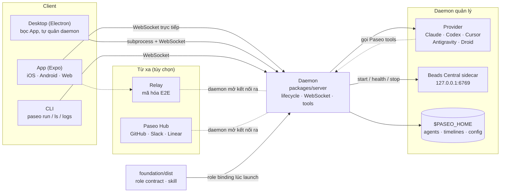
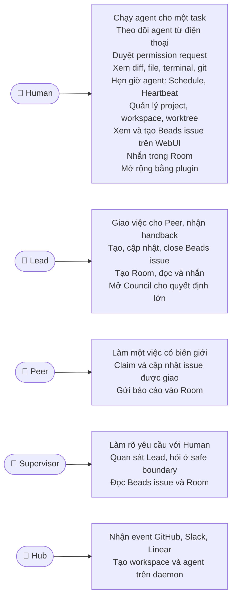
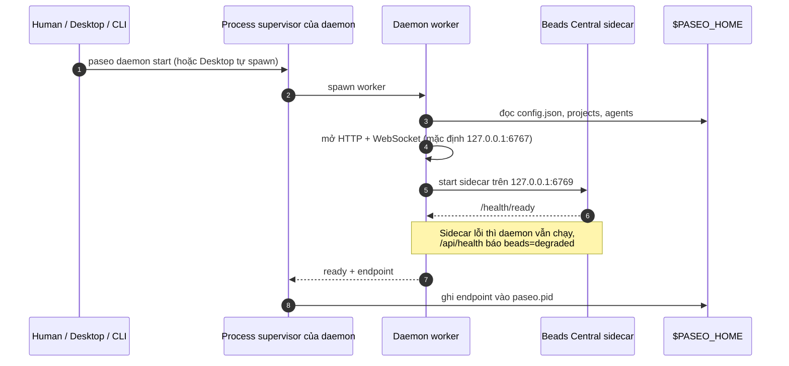
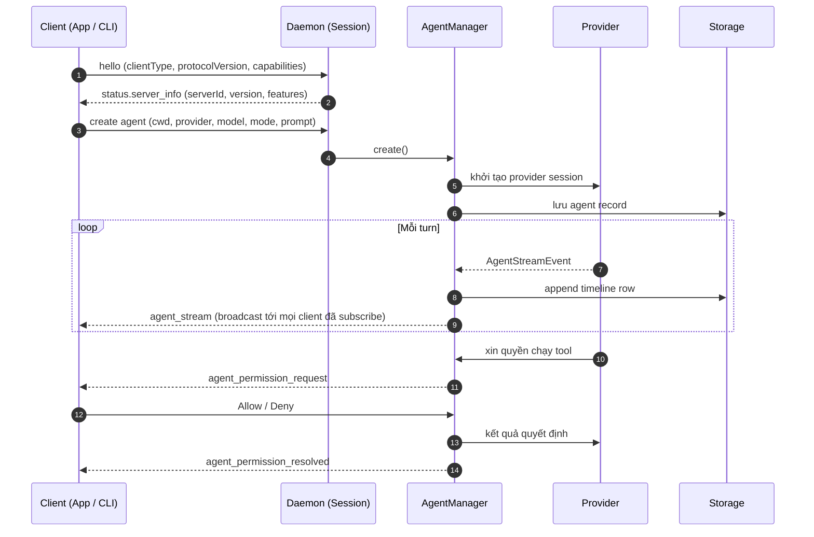
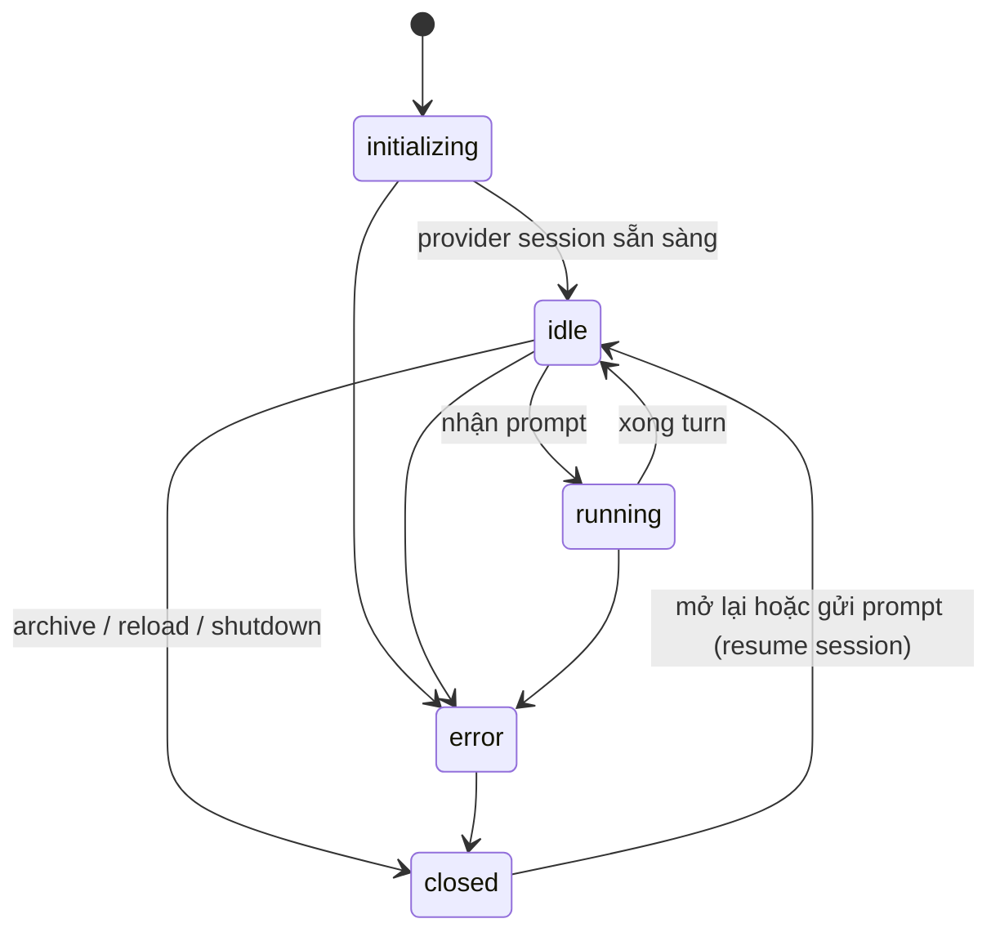
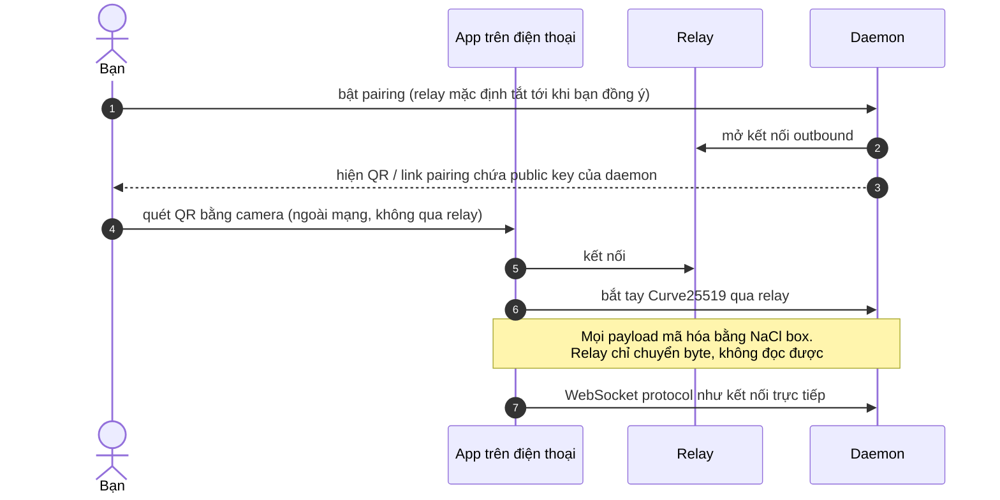
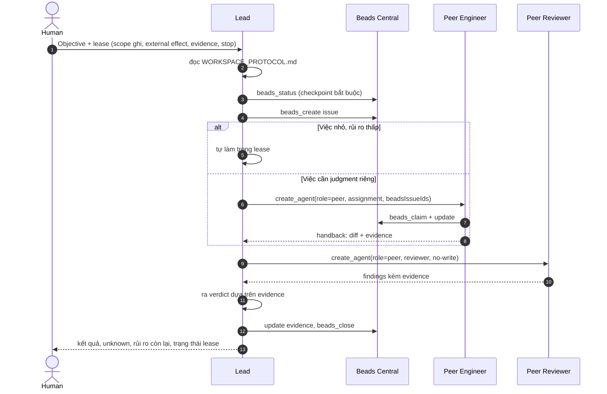
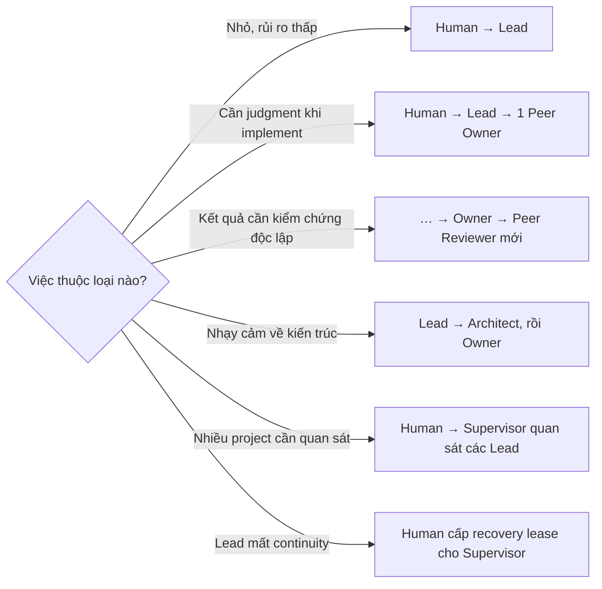
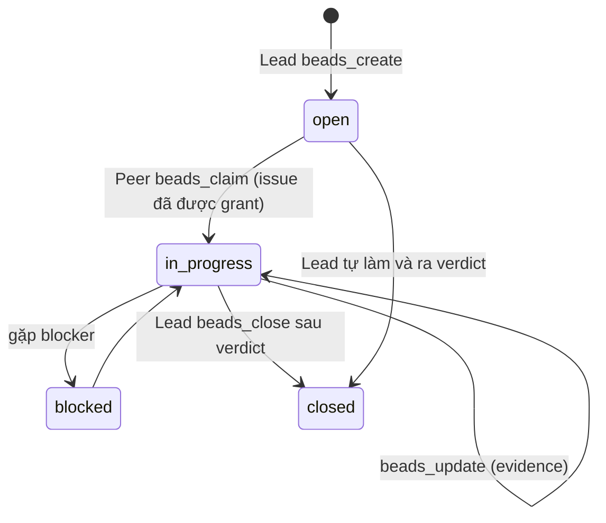
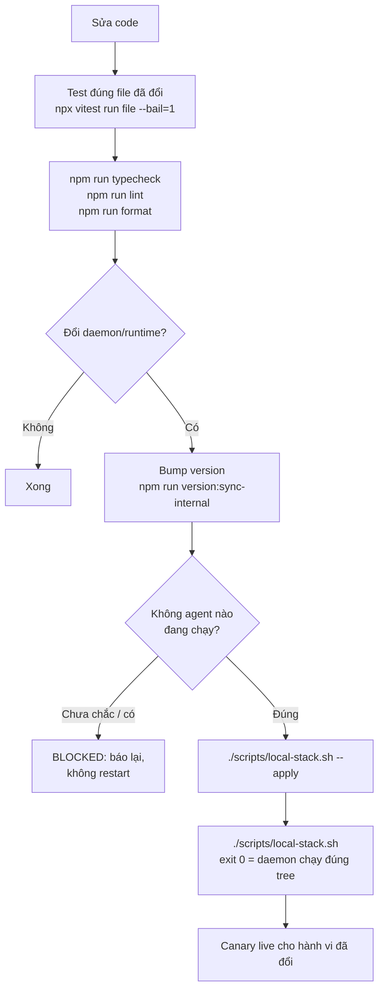

# Tổng quan dự án Paseo

Doc này là điểm vào cho người mới: Paseo làm gì, mỗi thành phần đảm nhận việc gì, ai dùng nó cho
việc gì, và các luồng chính chạy ra sao. Chi tiết của từng chủ đề nằm ở doc sở hữu chủ đề đó; doc
này chỉ nối chúng lại và link sang.

## Paseo là gì

Paseo cho bạn chạy, theo dõi và điều khiển coding agent (Claude Code, Codex, Cursor, Antigravity,
Factory Droid và custom provider dựa trên Codex) trên chính máy của bạn, từ desktop, điện thoại,
trình duyệt hoặc dòng lệnh. Code và credential ở lại trên máy bạn; Paseo không quản lý API key của
provider.

Repository này là bản downstream của upstream Paseo, gồm hai lớp:

| Lớp                  | Trả lời câu hỏi                                                             | Doc chính                                                                      |
| -------------------- | --------------------------------------------------------------------------- | ------------------------------------------------------------------------------ |
| **Paseo Product**    | Agent chạy ở đâu, stream thế nào, client kết nối ra sao                     | [product.md](product.md), [architecture.md](architecture.md)                   |
| **Paseo Foundation** | Ai có quyền gì khi nhiều agent cùng làm một việc (Supervisor — Lead — Peer) | [foundation-doctrine.md](foundation-doctrine.md), [slp-usage.md](slp-usage.md) |

Thuật ngữ (Project, Workspace, Agent session, Host, …) theo [glossary.md](glossary.md).

## Bản đồ thành phần

Daemon là trung tâm. Mọi client nói cùng một WebSocket protocol; provider chạy như process con của
daemon và gọi ngược lại daemon qua Paseo tool catalog để tạo agent, đọc room hoặc ghi Beads issue.

## Tác dụng của từng thành phần

### Packages trong monorepo

| Package                       | Tác dụng                                                                                                    | Ai dùng                         | Đọc thêm                                                                                |
| ----------------------------- | ----------------------------------------------------------------------------------------------------------- | ------------------------------- | --------------------------------------------------------------------------------------- |
| `packages/server`             | Daemon: tạo/chạy/dừng/archive agent, stream timeline, terminal, git, schedule, room, council, Beads adapter | Mọi client, mọi agent           | [architecture.md](architecture.md#packagesserver--the-daemon)                           |
| `packages/protocol`           | Zod schema cho mọi WebSocket message và binary frame; hợp đồng chung giữa daemon và client                  | server, app, cli, client        | [protocol-compatibility.md](protocol-compatibility.md)                                  |
| `packages/client`             | Driver WebSocket cấp thấp và SDK `PaseoClient`/`PaseoApi`                                                   | app, cli, plugin, app bên ngoài | [architecture.md](architecture.md#packagesclient--daemon-client-library-and-sdk-facade) |
| `packages/app`                | Giao diện Expo cho iOS, Android, Web; desktop dùng lại UI này                                               | Human                           | [architecture.md](architecture.md#packagesapp--mobile--web-client-expo)                 |
| `packages/desktop`            | Electron: bọc App, spawn và quản daemon local, multi-window, in-app browser                                 | Human trên macOS/Linux/Windows  | [architecture.md](architecture.md#packagesdesktop--desktop-app-electron)                |
| `packages/cli`                | Lệnh kiểu Docker (`paseo run/ls/logs/wait`, `daemon`, `schedule`, `workspace`…)                             | Human, script, agent            | [development.md](development.md)                                                        |
| `packages/relay`              | Kênh mã hóa E2E (Curve25519 + NaCl box) để điện thoại tới daemon sau firewall                               | App khi ở xa                    | [SECURITY.md](../SECURITY.md)                                                           |
| `packages/plugin`             | SDK viết plugin: provider mới, usage source, panel, nút, theme                                              | Người viết plugin               | [plugins.md](plugins.md)                                                                |
| `packages/foundation-cli`     | `paseo-foundation`: cài, kiểm tra (`doctor`), rollback Foundation distribution trên máy                     | Operator                        | [foundation-product.md](foundation-product.md)                                          |
| `packages/highlight`          | Syntax highlighting cho file và diff hiển thị trong App                                                     | app                             | —                                                                                       |
| `packages/expo-two-way-audio` | Native module stream audio hai chiều cho voice mode                                                         | app                             | —                                                                                       |
| `packages/website`            | Trang marketing paseo.sh                                                                                    | Người dùng mới                  | —                                                                                       |

### Thư mục khác ở root

| Thư mục                 | Tác dụng                                                                                                                                | Đọc thêm                                                              |
| ----------------------- | --------------------------------------------------------------------------------------------------------------------------------------- | --------------------------------------------------------------------- |
| `foundation/`           | Doctrine và role asset immutable, import từ một tag của repo Foundation; khóa bằng `manifest.json` + `sources.lock.json`. Không sửa tay | [foundation-product.md](foundation-product.md)                        |
| `skills/`               | Workflow skill bundle sẵn cho agent (`paseo`, `council`, `paseo-handoff`, …) và `role-admission.json`                                   | [skill-system.md](skill-system.md)                                    |
| `plugins/`              | Plugin first-party: Antigravity provider, các usage source (Claude, Codex, Cursor, Droid, …)                                            | [plugins.md](plugins.md)                                              |
| `plugin-examples/`      | Plugin mẫu để học cách viết plugin                                                                                                      | [plugins.md](plugins.md)                                              |
| `control-workspace/`    | Template thử nghiệm cho Control Workspace Home; mặc định không cài                                                                      | [foundation-product.md](foundation-product.md)                        |
| `public-docs/`          | Doc công khai cho người dùng cuối (web UI, CLI, Hub security)                                                                           | —                                                                     |
| `scripts/`              | Script dev/release, gồm `local-stack.sh` để build-install-restart stack local                                                           | [development.md](development.md)                                      |
| `WORKSPACE_PROTOCOL.md` | Luật riêng của repo cho agent role-bound: hotspot, routing, issue tracker, evidence                                                     | [foundation-doctrine.md](foundation-doctrine.md#ba-instruction-layer) |

### Ba vai trò của Foundation (SLP)

| Vai trò        | Việc chính                                                                                    | Không được làm                                         |
| -------------- | --------------------------------------------------------------------------------------------- | ------------------------------------------------------ |
| **Human**      | Đặt mục tiêu, cấp lease, giữ các quyết định ngoài lease, chọn Supervisor                      | —                                                      |
| **Supervisor** | Làm rõ yêu cầu với Human, quan sát chất lượng điều phối, recovery khi Human cấp lease riêng   | Ra lệnh kỹ thuật cho Lead, viết code, accept thay Lead |
| **Lead**       | Sở hữu outcome của một project: chọn topology, giao việc cho Peer, tích hợp, ra verdict       | Tự implement rồi tự accept một thay đổi lớn            |
| **Peer**       | Làm một việc có biên giới rõ (scout, engineer, reviewer, architect) rồi handback kèm evidence | Điều phối agent khác, tự nới scope, close Beads issue  |

Runtime mode (full-access hay no-write) chỉ là khả năng kỹ thuật, không phải quyền. Quyền đến từ
assignment. Chi tiết ở [foundation-doctrine.md](foundation-doctrine.md) và
[native-role-binding.md](native-role-binding.md).

## Use case

| Use case                       | Bạn làm gì                                                                                     | Bề mặt                      | Doc sở hữu                                 |
| ------------------------------ | ---------------------------------------------------------------------------------------------- | --------------------------- | ------------------------------------------ |
| Chạy agent cho một task        | Chọn workspace, provider, model, mode; gõ prompt vào Composer                                  | App, CLI `paseo run`        | [agent-lifecycle.md](agent-lifecycle.md)   |
| Theo dõi từ điện thoại         | Bật pairing, quét QR, mở App ở bất kỳ đâu                                                      | App qua relay               | [SECURITY.md](../SECURITY.md)              |
| Duyệt permission request       | Agent xin chạy tool; bạn Allow/Deny                                                            | App, CLI `paseo permit`     | [permissions.md](permissions.md)           |
| Xem diff, file, terminal       | Mở Explorer sidebar, Changes, Terminal trong workspace                                         | App, Desktop                | [explorer-sidebar.md](explorer-sidebar.md) |
| Hẹn giờ agent                  | Schedule tạo agent mới theo cron; Heartbeat nhắc lại vào agent đang có                         | App, CLI, MCP               | [glossary.md](glossary.md)                 |
| Project / workspace / worktree | Thêm project, tạo workspace Local hoặc New worktree, archive                                   | App, CLI                    | [glossary.md](glossary.md)                 |
| Giao việc cho Peer             | Lead gọi `create_agent` với role `peer` và assignment có biên giới                             | Agent tool                  | [slp-usage.md](slp-usage.md)               |
| Theo dõi việc bằng Beads issue | Tạo, claim, cập nhật, close issue theo quyền của role                                          | WebUI Issues, agent tool    | [beads-central.md](beads-central.md)       |
| Trao đổi qua Room              | Human và Lead đọc, nhắn, mention `@agent` để đánh thức agent; Peer chỉ gửi; Supervisor chỉ đọc | WebUI Rooms, agent tool     | [rooms.md](rooms.md)                       |
| Council                        | Lead mở nhiều Peer độc lập viết báo cáo kín, rồi ra một verdict                                | Agent tool, skill `council` | [skill-system.md](skill-system.md)         |
| Kích hoạt từ tích hợp          | Hub nhận event GitHub/Slack/Linear, tạo workspace và agent trên daemon                         | Hub                         | [hub.md](hub.md)                           |
| Mở rộng bằng plugin            | Thêm provider, usage source, panel, nút                                                        | Plugin SDK                  | [plugins.md](plugins.md)                   |

## Workflow chính

Các sơ đồ dưới đây là bản rút gọn để bạn nắm luồng. Chi tiết đúng nằm ở doc được link dưới mỗi sơ đồ;
khi hai nơi lệch nhau, doc đó thắng.

### 1. Daemon khởi động

Chỉ supervisor ghi endpoint vào `paseo.pid`; CLI tin record đó để tìm daemon. Xem
[architecture.md](architecture.md#storage) và [beads-central.md](beads-central.md#runtime-ownership).

### 2. Chạy một agent

Stream live chỉ để hiển thị nhanh; khi reconnect, client fetch timeline từ daemon làm nguồn đúng.
Xem [timeline-sync.md](timeline-sync.md).

### 3. Vòng đời agent

`closed` không phải đã xóa: agent giữ identity, timeline và session để resume. Archive là thao tác
riêng, ẩn agent khỏi danh sách đang hoạt động. Xem [agent-lifecycle.md](agent-lifecycle.md).

### 4. Kết nối điện thoại qua relay

QR là nguồn tin cậy duy nhất cho public key, nên đừng chia sẻ nó công khai. Không cần mở port hay cấu hình VPN. Nếu bạn tự host, kết nối trực tiếp, SSH hoặc VPN vẫn dùng được.
Xem [SECURITY.md](../SECURITY.md).

### 5. Điều phối nhiều agent theo SLP

Luật cốt lõi: mỗi scope đang thay đổi có đúng một writer; reviewer không có quyền ghi; status
`completed` hay test pass là tín hiệu, không phải acceptance. Chọn topology nhỏ nhất đủ an toàn theo
bảng trong [slp-usage.md](slp-usage.md#chọn-topology).

### 6. Vòng đời Beads issue

Mọi mutation cần `idempotencyKey`; Peer không close; Supervisor chỉ đọc. Xem
[beads-central.md](beads-central.md#authentication-và-authority).

### 7. Vòng phát triển trong repo này

Không chạy full test suite trên máy. Không sửa tay `foundation/dist`. Chi tiết ở
[development.md](development.md), [testing.md](testing.md) và mục Local completion gate trong
[CLAUDE.md](../CLAUDE.md#local-completion-gate).

## Đọc tiếp

| Bạn muốn                                 | Đọc                                                                                                |
| ---------------------------------------- | -------------------------------------------------------------------------------------------------- |
| Hiểu kiến trúc sâu hơn                   | [architecture.md](architecture.md), [data-model.md](data-model.md)                                 |
| Thêm provider                            | [providers.md](providers.md), [custom-providers.md](custom-providers.md)                           |
| Sửa protocol mà không làm hỏng client cũ | [protocol-compatibility.md](protocol-compatibility.md)                                             |
| Làm UI trong App                         | [design.md](design.md), [platform-gating.md](platform-gating.md), [expo-router.md](expo-router.md) |
| Chạy Foundation lần đầu                  | [foundation-first-run.md](foundation-first-run.md)                                                 |
| Mọi doc khác                             | [README.md](README.md)                                                                             |
