# Cơ chế SLP — Supervisor · Lead · Peer

Doc này giải thích SLP bằng sơ đồ: ai giữ quyền gì, việc đi qua những bước nào, và vì sao có từng
luật. Nó là bản rút gọn để học nhanh. Luật gốc nằm ở
[Canonical Role Contracts](../foundation/dist/docs/ROLE_CONTRACTS.md) và
[Demonthorn Deep Dive](../foundation/dist/references/demonthorn-agent-orchestration-deep-dive.md);
khi hai nơi lệch nhau, nguồn gốc thắng.

## SLP là gì

SLP là cách tổ chức nhiều coding agent cùng làm một việc mà không biến thành một đàn agent phẳng ai
cũng sửa, ai cũng tự duyệt. Nó tách ba loại trách nhiệm cho ba vai trò, và Human đứng trên cùng.

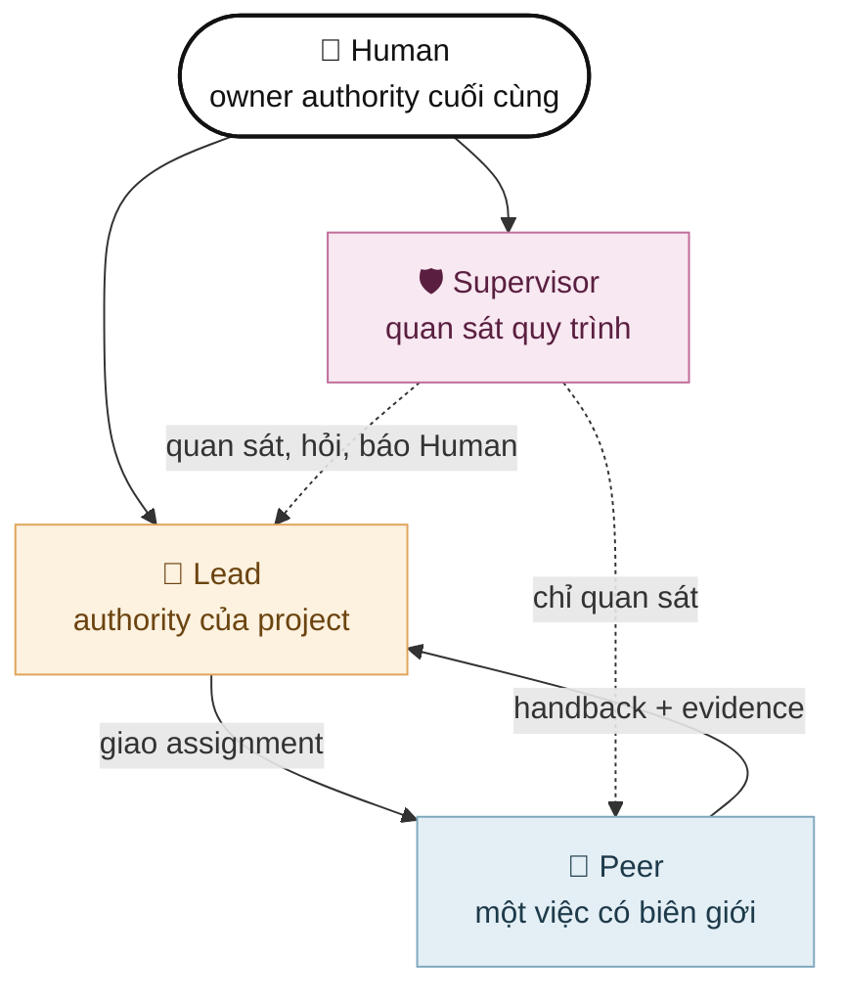

Đây không phải bậc thang `Supervisor > Lead`. Hai vai trò có hai loại quyền khác nhau:

- **Lead** là người quyết trong project của mình: chia việc, chọn ai làm, tích hợp, và chốt kết quả.
- **Supervisor** đứng ngoài luồng làm việc để thấy những thiên lệch mà Lead không tự thấy. Supervisor
  không phải một Lead cấp cao hơn.
- **Peer** là đồng nghiệp độc lập nhận đúng một việc. Peer có quyền nói "tiền đề này sai".
- **Human** giữ các quyết định không agent nào được tự suy ra: mục tiêu, ưu tiên, rủi ro, chi phí,
  tác động ra ngoài, và trade-off cuối cùng.

Năm ý cần nhớ:

1. Lead không viết một kế hoạch hoàn hảo rồi thuê bot gõ code. Lead giữ bối cảnh, đặt câu hỏi mở,
   phân quyền, nghe phản biện và chốt quyết định.
2. Peer là đồng nghiệp độc lập. Cùng một Peer có thể làm Engineer, Architect, Reviewer hay Scout tùy
   assignment.
3. Supervisor bảo vệ chất lượng quy trình, không sở hữu kết quả kỹ thuật.
4. Role profile giữ hành vi ổn định, `WORKSPACE_PROTOCOL.md` giữ chiến thuật riêng của repo,
   assignment giữ việc cụ thể. Trộn ba lớp này làm agent mất tập trung.
5. Trạng thái, thông báo hay test pass chỉ là tín hiệu. Chấp nhận kết quả cần evidence và đúng người
   có quyền.

## Vai trò

### So sánh nhanh

| Vai trò        | Mục tiêu                                              | Được làm                                                                                                    | Không được làm                                                                         |
| -------------- | ----------------------------------------------------- | ----------------------------------------------------------------------------------------------------------- | -------------------------------------------------------------------------------------- |
| **Human**      | Đặt mục tiêu và giới hạn                              | Cấp lease, giữ quyết định ngoài lease, chọn Supervisor, duyệt handoff Lead                                  | —                                                                                      |
| **Lead**       | Biến mục tiêu thành kết quả đáng tin                  | Chọn topology, tạo Peer từ roster đã duyệt, trả lời phản biện, mở Council, tạo và close issue, ra verdict   | Tự làm rồi tự duyệt thay đổi lớn, giao lời giải dựng sẵn, cho hai writer chung scope   |
| **Peer**       | Làm xong một việc có biên giới và giữ phán đoán riêng | Làm trong scope được giao, phản biện bằng evidence, claim và cập nhật issue được giao, gửi báo cáo vào Room | Tạo hay điều phối agent khác, tự nới scope, tự tuyên bố đã được chấp nhận, close issue |
| **Supervisor** | Bảo vệ chất lượng quy trình và sự liên tục cho Human  | Quan sát, hỏi Lead hoặc Peer một câu có evidence, báo Human, ghi notebook, đề xuất sửa protocol             | Lập kế hoạch hay chia việc sản phẩm, ra lệnh cho Peer, sửa code, duyệt kết quả         |

### Lead

Lead là binding engineering authority cho một project. Trước khi điều phối, Lead xác định danh tính
và workspace của mình, đọc hết `WORKSPACE_PROTOCOL.md`, rồi chỉ chuyển cho Peer những ràng buộc liên
quan.

Khi nào Lead tự làm:

| Loại việc                            | Ai làm                                           |
| ------------------------------------ | ------------------------------------------------ |
| Rất nhỏ, gắn chặt, protocol cho phép | Lead tự làm                                      |
| Implement có biên giới               | Một Peer Engineer                                |
| Kiến trúc khó                        | Architect chỉ đọc trước, Engineer sau            |
| Duyệt khó                            | Reviewer chưa từng tham gia implement            |
| Quyết định sản phẩm, chủ quan        | Đưa evidence cho Human, không giả lập bằng chứng |

### Peer và các disposition

Peer là một profile mỏng. Assignment quyết định lần này Peer làm gì:

| Disposition   | Việc                                                           | Quyền ghi                      |
| ------------- | -------------------------------------------------------------- | ------------------------------ |
| **Engineer**  | Implement đúng một scope đang thay đổi, tự kiểm write của mình | Có, theo write lease chính xác |
| **Architect** | Phân tích ownership, lifecycle, phương án, phản biện mạnh nhất | Không                          |
| **Reviewer**  | Cố bác bỏ một candidate đã ổn định                             | Không, bị khóa no-write        |
| **Scout**     | Tìm code, thu thập evidence, báo lại                           | Không                          |
| **Shadow**    | Shadow implementer; việc cụ thể do assignment định             | Chỉ khi có write lease         |

Khi tiền đề sai, Peer dừng và trả về một trong bốn yêu cầu, kèm evidence:

| Yêu cầu              | Khi nào                                                                  |
| -------------------- | ------------------------------------------------------------------------ |
| `REOPEN_REQUEST`     | Tiền đề, lifecycle, ownership hay API của việc được giao không đứng vững |
| `DEPENDENCY_REQUEST` | Cần một việc khác xong trước                                             |
| `BLOCKED`            | Không thể tiếp tục trong quyền hiện có                                   |
| `COUNCIL_REQUEST`    | Quyết định đủ lớn để cần nhiều góc nhìn độc lập                          |

Độc lập không có nghĩa là phản đối cho có. Phản biện phải có evidence.

### Supervisor

Supervisor nhìn rộng hơn một task: hội thoại Lead–Peer, lịch sử session và git, lỗi lặp lại, mất
đà, quyết định bị quên sau compaction. Mỗi phát hiện được báo theo khuôn:

```text
Observation → Evidence → Suspected mechanism → Impact → Question → Recommendation → Escalation?
```

Không có recovery lease thì Supervisor chỉ quan sát và khuyên. Khi Human cấp recovery lease chính xác
và Lead không phản hồi hoặc việc tiếp tục gây rủi ro lớn, Supervisor được gửi `STOP`/`FREEZE` có giới
hạn hoặc chuyển nguyên văn quyết định của Human tới Peer, đồng thời báo Lead và Human.

### Runtime mode không phải quyền

Mode của runtime do Human đặt qua daemon. Nó chỉ là khả năng kỹ thuật; quyền thật đến từ assignment.

| Vai trò    | Assignment                     | Runtime mode                  |
| ---------- | ------------------------------ | ----------------------------- |
| Lead       | mọi loại                       | bypass / full-access          |
| Peer       | thường                         | bypass / full-access          |
| Peer       | reviewer, `independent-review` | no-write do provider ép       |
| Supervisor | `read-only` (quan sát)         | no-write do provider ép       |
| Supervisor | `delegation` (điều phối)       | ask, Human duyệt từng request |
| Supervisor | `bootstrap` / `recovery`       | bypass trong đúng lease       |

Bypass dưới assignment no-write là chủ ý: agent tự giữ biên giới ghi và làm tiếp. Khi daemon cần khóa
no-write mà provider không làm được, launch thất bại thay vì hạ xuống full-access.

## Cơ chế

### Ba lớp instruction

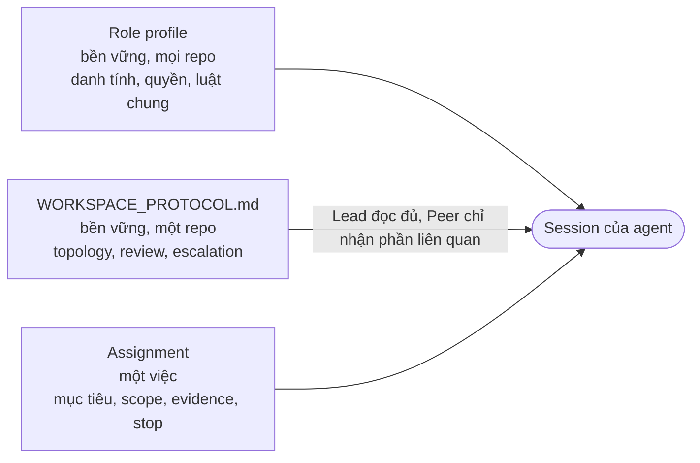

| Lớp                     | Chủ sở hữu      | Chứa                                                     | Không chứa                     |
| ----------------------- | --------------- | -------------------------------------------------------- | ------------------------------ |
| Role profile            | Foundation      | Danh tính, quyền, luật chống anti-pattern                | Chiến thuật riêng của một repo |
| `WORKSPACE_PROTOCOL.md` | Repository      | Hotspot, routing, issue tracker, cách review và escalate | Chi tiết một task              |
| Assignment              | Human hoặc Lead | Mục tiêu, scope, quyền, evidence, handback, stop         | Toàn bộ sổ tay tổ chức         |

### Assignment

Assignment là gói một việc. Nó chỉ chứa những gì làm thay đổi quyền, cách làm hoặc cách chấp nhận.

```text
Objective:        kết quả quan sát được, không kèm lời giải
Rationale:        kết quả Human cần, tách khỏi giải pháp đang thử (tùy chọn)
Open assumptions: giả định chưa kiểm, Peer được mở lại bằng evidence (tùy chọn)
Authority:        ai được ghi, ghi ở đâu, tác động ra ngoài nào | no-write
Evidence:         hành vi hoặc kiểm tra cần thấy
Handback/stop:    nộp lại gì, dừng khi nào
```

Đừng nhét giải pháp ưa thích vào objective. Peer nhận "làm WebSocket server" sẽ tối ưu WebSocket; Peer
nhận thêm "trình duyệt phải thấy trạng thái cuộc gọi trước khi đổ chuông, WebSocket chỉ là ứng viên"
mới có căn cứ để nói hướng này sai.

### Handback và verdict

```text
Outcome:                 complete | partial | blocked | reopen requested
Snapshot/candidate:      Git identity hoặc định danh chính xác
Changed/inspected scope: đường dẫn
Verification/skips:      kết quả tự tay kiểm, kể cả cái đã bỏ qua
Unknowns/risks:          chỉ cái quan trọng
Ownership/lease:         đã trả | còn giữ, kèm lý do
```

Lead xem artifact thật rồi ra một trong bốn verdict: `ACCEPT`, `REOPEN`, `REJECT`, `UNKNOWN`.

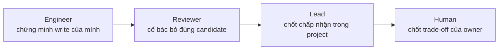

Test pass chứng minh một tập hành vi. Nó không chứng minh kiến trúc tốt, sản phẩm đúng, hay được phép
deploy.

### Một writer cho mỗi scope

Mỗi scope đang thay đổi có đúng một write Owner. Reviewer chỉ nhận candidate đã đứng yên.

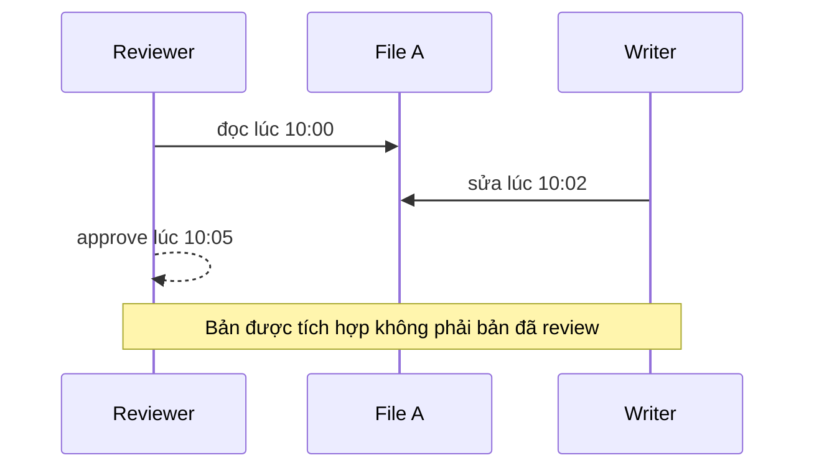

Candidate ổn định có thể là một commit, hoặc snapshot workspace có định danh khi chưa có quyền commit.

### Evidence mạnh hơn trạng thái

| Là evidence                        | Chỉ là tín hiệu                  |
| ---------------------------------- | -------------------------------- |
| Bytes hiện tại, Git identity, diff | Trạng thái `completed` của agent |
| Kiểm tra tập trung có kết quả thật | Thông báo, im lặng               |
| Hành vi tái hiện được              | Mức tự tin của model             |
| Review độc lập trên đúng candidate | Một test pass đơn lẻ             |

Thiếu evidence thì giữ kết luận là `UNKNOWN`, `BLOCKED` hoặc `REOPEN`. Đừng lấp chỗ trống bằng suy luận
tiện tay.

### Beads issue graph

Beads Central là sổ việc bền vững bắt buộc. Mọi vai trò gọi `beads_status` khi bắt đầu assignment.
Central không chạy thì việc ghi bị `BLOCKED`, không chuyển sang tracker khác.

| Vai trò    | Quyền                                                 |
| ---------- | ----------------------------------------------------- |
| Human      | Xem, tạo, close issue trên WebUI                      |
| Lead       | Tạo, cập nhật, thêm dependency; close chỉ sau verdict |
| Peer       | Claim và cập nhật đúng issue được giao; không close   |
| Supervisor | Chỉ đọc                                               |

Lead giao issue khi nó còn `open` và chưa có người nhận; Peer claim trước rồi mới cập nhật. Trạng thái
issue không cấp quyền và không chứng minh kết quả được chấp nhận.

### Room

Room là kênh nhắn tin chung cho Human và agent. Nó không cấp quyền, không chuyển ownership.

| Vai trò    | Tạo Room | Đọc | Gửi |
| ---------- | -------- | --- | --- |
| Lead       | ✓        | ✓   | ✓   |
| Peer       | —        | —   | ✓   |
| Supervisor | —        | ✓   | —   |

Peer gửi được nhưng không đọc được, nên ghế Council công bố báo cáo của mình mà không thấy báo cáo của
ghế khác.

### Tín hiệu điều phối và câu hỏi attention

Tín hiệu điều phối là thông báo bền vững để gây chú ý. Nó không phải lệnh và không chuyển quyền. Nếu
agent đang chạy, tín hiệu chờ tới lúc agent rảnh mới được giao.

Supervisor hỏi Lead hoặc Peer bằng một câu hỏi attention có ba phần bắt buộc: observation, một câu hỏi
mở kết thúc bằng `?`, và evidence. Runtime từ chối câu có dạng ra lệnh, phán quyết, chấp nhận, chuyển
quyền hay ghi, kể cả khi viết thành câu hỏi.

### Khi nào tín hiệu tự phát

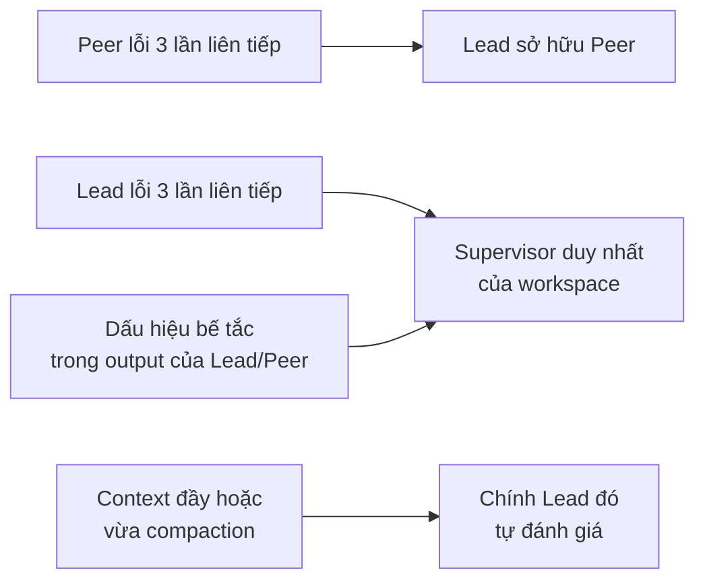

Không có đúng một Supervisor thì tín hiệu dành cho Supervisor không được phát. Một tín hiệu đơn chỉ là
lời khuyên; nó không đủ để thay Lead hay đổi quyền.

### Thay Lead (adjacent-Lead handoff)

Khi một Lead mất liên tục, nó được thay bằng một Lead mới qua một gói bàn giao đóng băng. Gói gồm mục
tiêu, scope, trạng thái, writer hiện tại, các quyết định đã chốt, cách đã thất bại, cách đã hiệu quả,
evidence, rủi ro, và điểm tiếp tục.

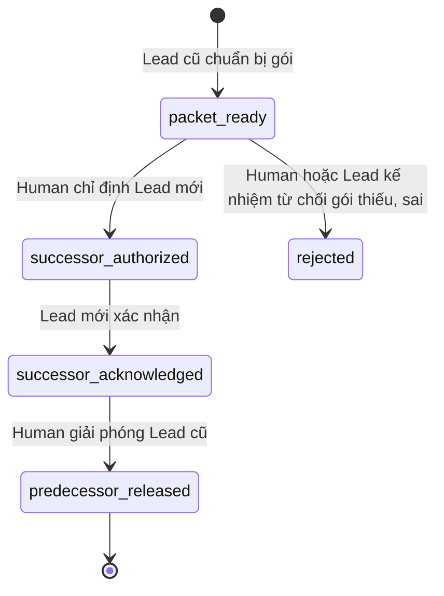

Chỉ bước cuối mới đổi quyền: Lead cũ bị đóng, write Owner chuyển sang Lead mới, và mọi prompt mới tới
Lead cũ bị từ chối. Bản ghi và timeline vẫn được giữ để audit.

### Council

Council dùng cho quyết định lớn, khó đảo ngược. Lead mở các ghế Peer mới, mỗi ghế có nhiệm vụ riêng,
viết báo cáo kín, rồi Lead ra một verdict duy nhất. Council không phải bỏ phiếu.

| Cấp                 | Ghế                                      | Dùng khi                                   |
| ------------------- | ---------------------------------------- | ------------------------------------------ |
| `lens`              | Một Architect hoặc một Reviewer          | Một góc nhìn là đủ                         |
| `debate`            | Architect + Reviewer                     | Mặc định cho Council khó                   |
| `debate-with-proof` | Scout + Architect + Reviewer             | Cần kiểm chứng evidence làm đổi quyết định |
| `high-risk`         | Ba ghế trên, giới hạn chặt, STOP rõ ràng | Rủi ro cao                                 |

## Workflow

Các sơ đồ dưới đây là bản rút gọn. Chi tiết đúng nằm ở doc được link; khi hai nơi lệch nhau, doc đó
thắng.

### 1. Vòng đời một assignment

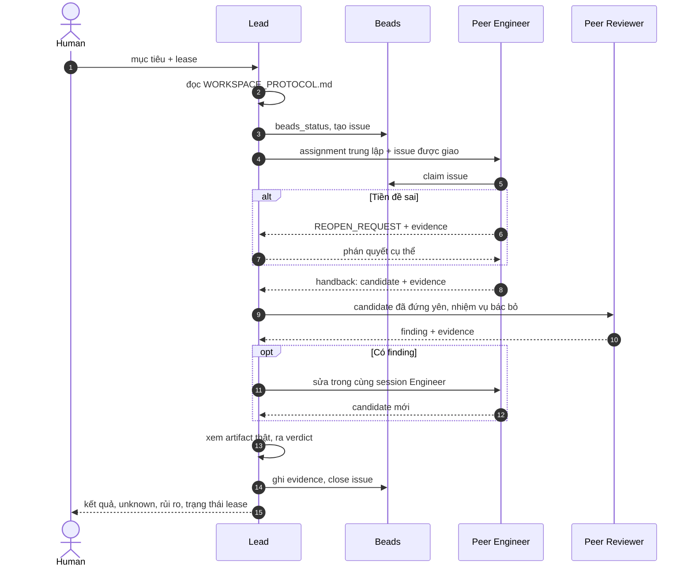

Xem [Assignment và Handback](../foundation/dist/docs/ASSIGNMENT_AND_HANDBACK.md).

### 2. Chọn topology

Chọn topology nhỏ nhất vẫn giữ được ownership, phán đoán độc lập và quyền chấp nhận. Thêm một node phải
trả lời được nó giảm rủi ro nào mà topology nhỏ hơn không giảm được.

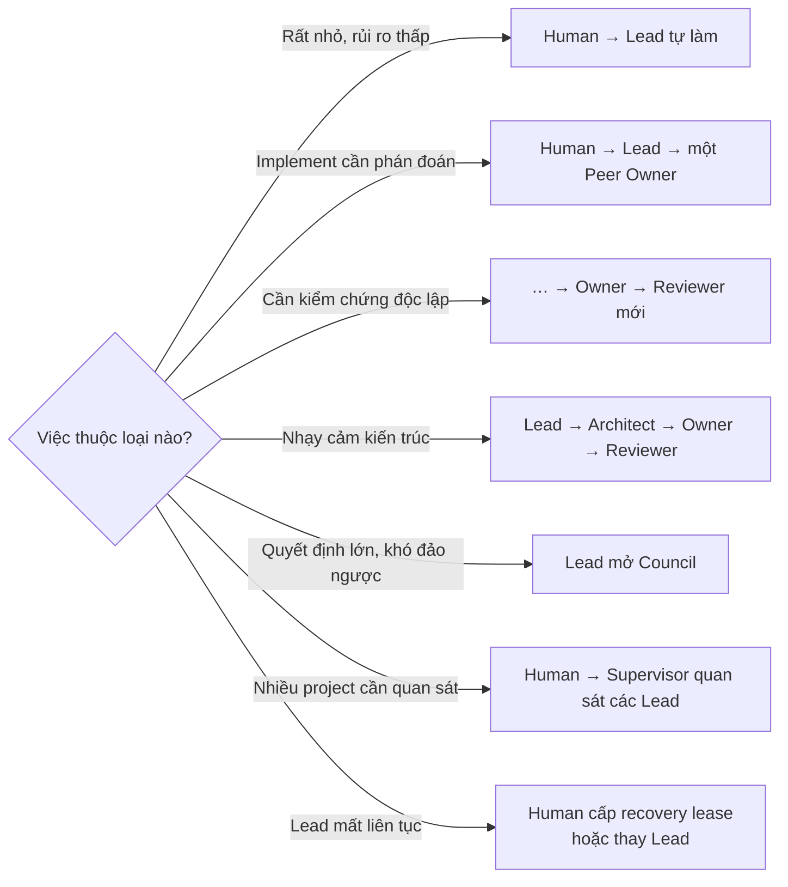

Xem [SLP usage](slp-usage.md#chọn-topology).

### 3. Lát cắt nhạy cảm kiến trúc

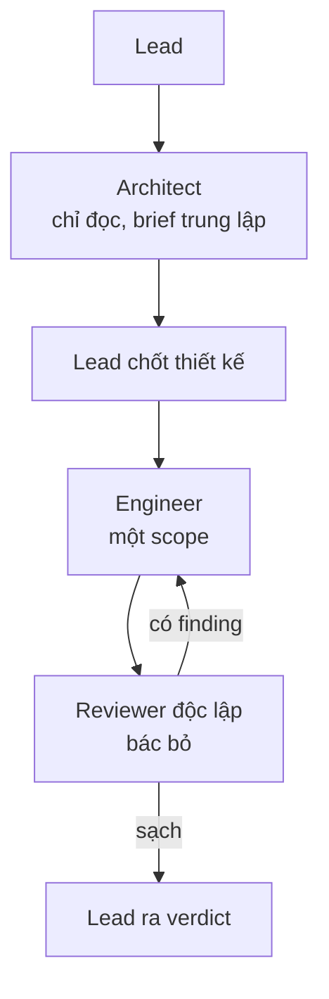

### 4. Council

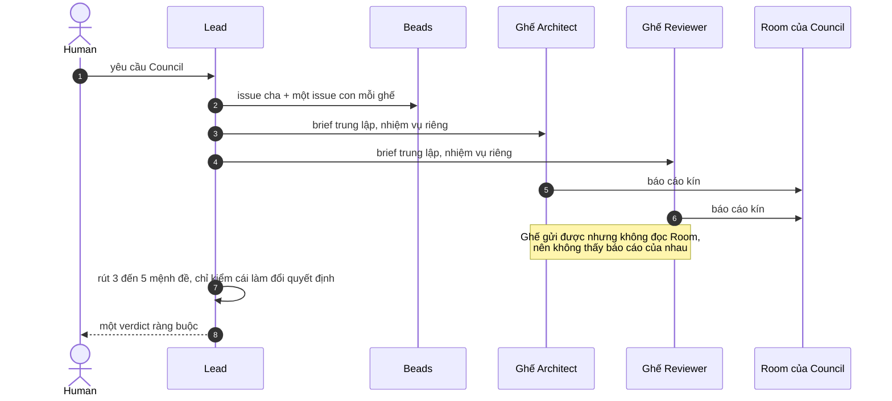

Xem [skill council](../skills/council/SKILL.md).

### 5. Supervisor phát hiện vấn đề

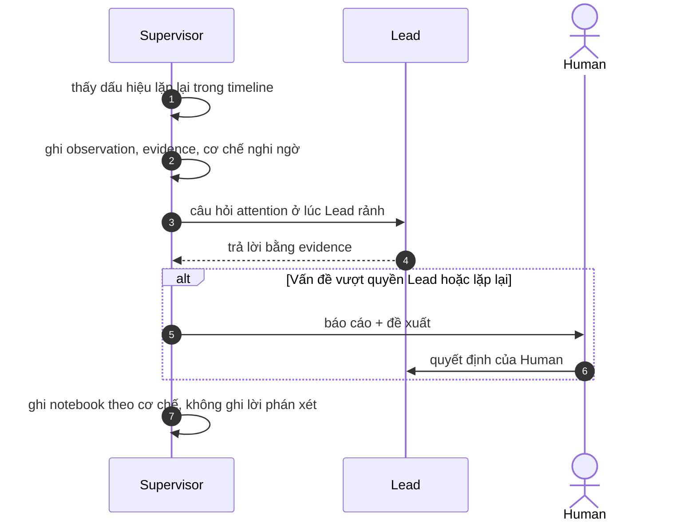

Supervisor không sửa code, không ra lệnh cho Peer, không duyệt kết quả. Xem
[Supervisor Notebook](../foundation/dist/docs/SUPERVISOR_NOTEBOOK.md).

### 6. Recovery khi Lead mất kiểm soát

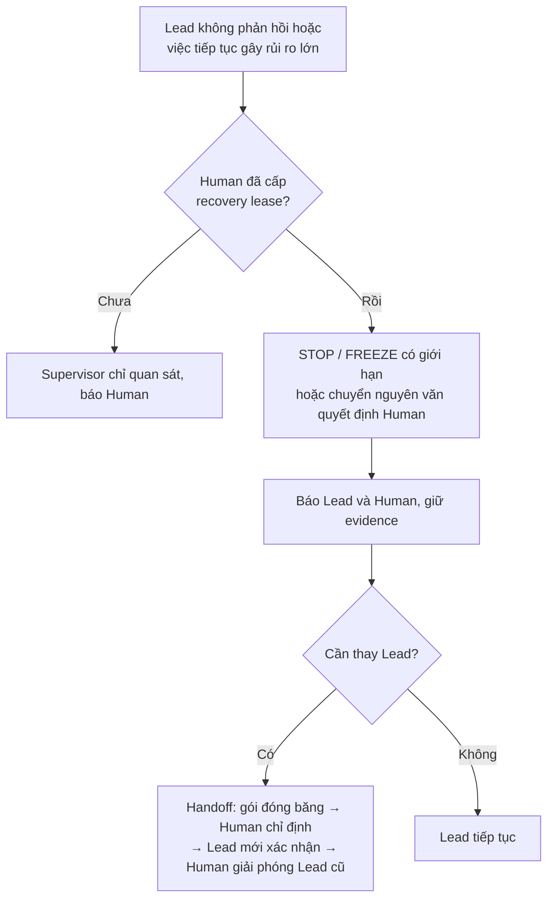

Xem [SLP coordination và handoff](slp-coordination-handoff.md).

### 7. Vòng đời Beads issue

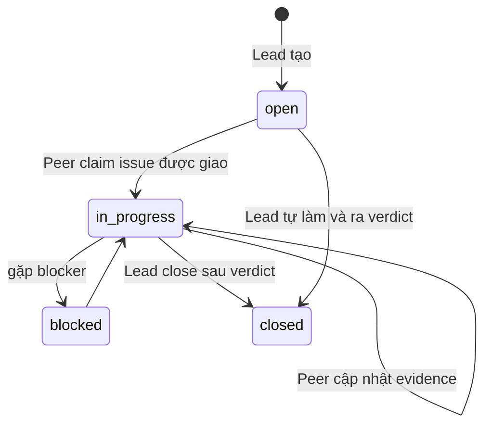

Xem [Beads Central](beads-central.md).

## Use case

| Tình huống                                      | Topology                                           | Điểm mấu chốt                                                   |
| ----------------------------------------------- | -------------------------------------------------- | --------------------------------------------------------------- |
| Sửa một lỗi nhỏ, rõ ràng                        | Human → Lead tự làm                                | Protocol phải cho phép; không thêm Peer chỉ cho đủ thủ tục      |
| Làm một tính năng có biên giới                  | Lead → một Peer Engineer                           | Brief trung lập; Engineer tự kiểm write; Lead xem artifact thật |
| Thay đổi save schema, migration                 | Lead → Architect → Engineer → Reviewer             | Thiết kế chốt trước; Reviewer chưa từng implement               |
| Chọn giữa hai kiến trúc khó đảo ngược           | Council `debate`                                   | Báo cáo kín, nhiệm vụ khác nhau, một verdict của Lead           |
| Peer phát hiện tiền đề sai giữa chừng           | Peer → `REOPEN_REQUEST`                            | Dừng patch không tương thích, nộp evidence; Lead phán quyết     |
| Reviewer tìm thấy lỗi                           | Sửa trong cùng session Engineer                    | Candidate mới phải được review lại                              |
| Nhiều project chạy song song                    | Human → Supervisor quan sát các Lead               | Mỗi Lead vẫn giữ quyền project mình; Supervisor nhìn ngang      |
| Human hỏi Lead quá nhiều làm Lead mất tập trung | Human hỏi Supervisor, Supervisor chuyển quyết định | Giữ attention của Lead cho điều phối                            |
| Lead lặp lại cùng một lỗi ba lần                | Tín hiệu tự phát tới Supervisor                    | Supervisor hỏi bằng evidence, không tự sửa                      |
| Lead đầy context, mất liên tục                  | Adjacent-Lead handoff                              | Gói đóng băng; Human chỉ định và giải phóng                     |

## Anti-pattern

| Anti-pattern                    | Dấu hiệu                                                          | Phản ứng                                                                   |
| ------------------------------- | ----------------------------------------------------------------- | -------------------------------------------------------------------------- |
| Sheep                           | Peer lặp lại tiền đề của Lead, câu nào cũng "đồng ý"              | Gửi evidence và câu hỏi mở; đòi `CONFIRM`, `PARTIAL`, `CHALLENGE`, `BLOCK` |
| Pre-solving                     | Plan định sẵn mọi file, API; Peer chỉ được PASS/FAIL              | Biến plan thành bản đồ tạm; cho Peer mở lại tiền đề                        |
| Tối ưu cái dù thay vì làm phanh | Lần sửa thứ ba vẫn cùng triệu chứng                               | Dừng vá cục bộ, hỏi cơ chế chung nào gây cả chuỗi lỗi                      |
| Architecture lock-in            | Mỗi thay đổi cần thêm adapter                                     | Review kiến trúc độc lập, phương án thay thế, điều kiện đảo ngược          |
| Moving-scope collision          | Hai Engineer sửa cùng subsystem                                   | Một writer mỗi scope, worktree riêng, candidate ổn định                    |
| Self-acceptance                 | Cùng agent thiết kế benchmark, implement, rồi tuyên bố thành công | Lead/Human đặt tiêu chí; Reviewer độc lập cho quyết định quan trọng        |
| Test-shaped proof               | Test viết để khớp implementation                                  | Hỏi test sẽ fail dưới cơ chế sai nào                                       |
| Polling                         | Lead hỏi liên tục "xong chưa"                                     | Chờ thông báo; sau hai lỗi giống nhau thì kiểm điều kiện tiên quyết        |
| Ceremony capture                | Việc nào cũng Council, nhiều vote                                 | Topology nhỏ nhất; Council chỉ cho mệnh đề làm đổi quyết định              |
| Forked independence             | Reviewer là bản fork của Lead mà gọi là độc lập                   | Session mới, brief trung lập, đúng candidate                               |
| Status-as-acceptance            | "finished" được báo thành xong mà chưa xem diff                   | Trạng thái chỉ đánh thức người có quyền; chấp nhận dựa trên artifact       |
| Supervisor overreach            | Supervisor tự sửa code hoặc quản vi mô Peer                       | Đặt câu hỏi có evidence, chuyển quyết định Human, đề xuất handoff          |

Danh sách đủ ở mục 8 của
[Deep Dive](../foundation/dist/references/demonthorn-agent-orchestration-deep-dive.md) và
[foundation-doctrine.md](foundation-doctrine.md#anti-pattern-cần-chặn-sớm).

## Đọc tiếp

| Bạn muốn                                | Đọc                                                                                               |
| --------------------------------------- | ------------------------------------------------------------------------------------------------- |
| Luật chuẩn của từng vai trò             | [Canonical Role Contracts](../foundation/dist/docs/ROLE_CONTRACTS.md)                             |
| Doctrine đầy đủ, triết lý, anti-pattern | [Demonthorn Deep Dive](../foundation/dist/references/demonthorn-agent-orchestration-deep-dive.md) |
| Mẫu assignment và handback              | [Assignment và Handback](../foundation/dist/docs/ASSIGNMENT_AND_HANDBACK.md)                      |
| Vận hành hằng ngày                      | [SLP usage](slp-usage.md)                                                                         |
| Tín hiệu điều phối và thay Lead         | [SLP coordination và handoff](slp-coordination-handoff.md)                                        |
| Doctrine theo góc nhìn sản phẩm         | [Foundation doctrine](foundation-doctrine.md)                                                     |
| Council                                 | [skill council](../skills/council/SKILL.md)                                                       |
